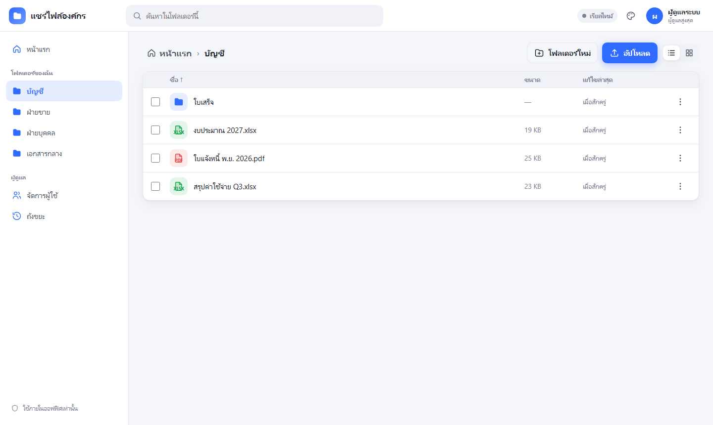
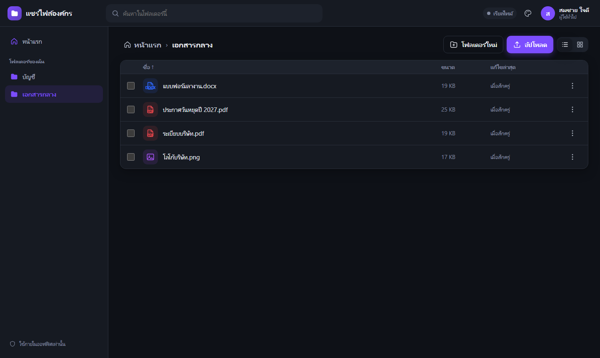
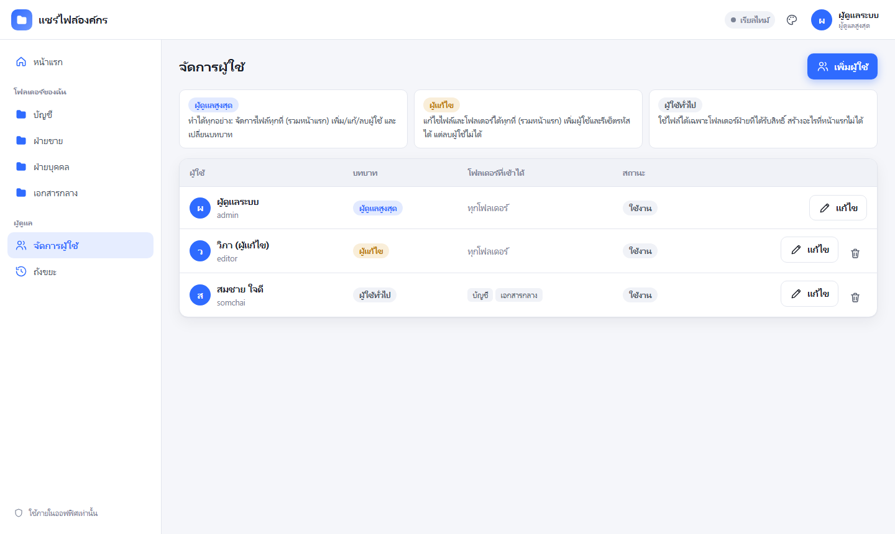

# LANShare · แชร์ไฟล์องค์กร

เว็บแอปแชร์ไฟล์ภาษาไทยสำหรับใช้ **ภายในวง LAN/Wi-Fi ของออฟฟิศ** ทำงานแบบ **ออฟไลน์ 100%** ไม่ต้องต่ออินเทอร์เน็ต ไม่ต้องติดตั้งไลบรารีเพิ่ม (Python มาตรฐานล้วน) ออกแบบให้ใช้คู่กับเซิร์ฟเวอร์ไฟล์ Samba บน Proxmox ได้ทันที



## ความสามารถ

- **3 ระดับสิทธิ์**
  | บทบาท | ไฟล์และโฟลเดอร์ | จัดการผู้ใช้ |
  |---|---|---|
  | ผู้ดูแลสูงสุด | ทุกที่ รวมหน้าแรก (สร้างโฟลเดอร์ฝ่ายใหม่ได้) | เพิ่ม แก้ไข ลบ เปลี่ยนบทบาท |
  | ผู้แก้ไข | ทุกที่ รวมหน้าแรก | เพิ่มผู้ใช้ทั่วไป รีเซ็ตรหัส ปิดใช้งาน — **ลบผู้ใช้ไม่ได้** |
  | ผู้ใช้ทั่วไป | เฉพาะโฟลเดอร์ฝ่ายที่ได้รับสิทธิ์ (สร้างที่หน้าแรกไม่ได้) | — |
- **อัปเดตแบบเรียลไทม์** ด้วย Server-Sent Events — ไฟล์ที่คนอื่นเพิ่มหรือลบ (ทั้งจากหน้าเว็บและจากไดรฟ์ Windows) ขึ้นเองภายใน 2–3 วินาที
- **ธีม 9 สี** (ค่าเริ่มต้น น้ำเงินเข้ม–ทอง) และ **โหมดกลางวัน / กลางคืน / ตามเครื่อง** จำค่าไว้ในเบราว์เซอร์
- **ข้อความแจ้งเตือนหายเอง** (สำเร็จ 3.5 วินาที, ผิดพลาด 6 วินาที, ชี้เมาส์ค้างไว้เพื่อหยุด)
- ลากไฟล์หรือทั้งโฟลเดอร์ (รวมโฟลเดอร์ย่อย) มาวางเพื่ออัปโหลดพร้อมแถบความคืบหน้า, ค้นหาในโฟลเดอร์, ดูตัวอย่างรูป/PDF/ข้อความ, มุมมองรายการหรือไอคอน, ใช้บนมือถือได้
- **ถังขยะ** — ไฟล์ที่ลบไปอยู่ในถังขยะ กู้คืนได้
- **บันทึกกิจกรรม** (ผู้ดูแลสูงสุด) — ใคร ทำอะไร กับไฟล์ไหน เมื่อไหร่ จากเครื่องไหน ทั้งจากหน้าเว็บและจากไดรฟ์ Windows (Samba `full_audit`) กรองตามคน/ประเภท/ช่องทาง ค้นหา และส่งออก CSV
- **สถานะออนไลน์ในแชท** — เห็นว่าใครกำลังใช้งาน หรือใช้งานล่าสุดเมื่อไหร่
- **ไอคอนประจำฝ่าย** — เลือกจากชื่อฝ่ายอัตโนมัติ (บัญชี ขาย บุคคล ไอที …) และสีธีมเปลี่ยนทั้งหน้า
- **แชทในองค์กร (ออฟไลน์)** — ห้อง "ทุกคน", ห้องของแต่ละฝ่าย (เห็นเฉพาะคนที่เข้าโฟลเดอร์นั้นได้) และข้อความส่วนตัวถึงใครก็ได้ ส่งรูปได้ (เลือกไฟล์ / วางจากคลิปบอร์ด / ลากมาวาง) กดแสดงความรู้สึกต่อข้อความแบบ Messenger ข้อความขึ้นทันทีพร้อมตัวนับยังไม่อ่านและแจ้งเตือน เก็บบนเซิร์ฟเวอร์ในออฟฟิศเท่านั้น
- **ชื่อองค์กรของคุณ** — ถามตอนติดตั้ง และแก้ได้ที่ ตั้งค่าระบบ (แสดงที่หน้าเข้าสู่ระบบ แถบด้านบน และชื่อแท็บ) พร้อมโลโก้ตัวอักษรย่อ
- **ลบบัญชีของตัวเอง** — ยืนยันด้วยรหัสผ่าน (ผู้ดูแลสูงสุดคนสุดท้ายลบตัวเองไม่ได้)
- **รูปโปรไฟล์** — แต่ละคนอัปโหลดรูปของตัวเองได้จากเมนูมุมขวาบน (ตัดเป็นสี่เหลี่ยม 256 px ในเบราว์เซอร์)
- **ตั้งค่าเครือข่าย** (ผู้ดูแลสูงสุด) — สลับ IP ของเซิร์ฟเวอร์ระหว่างที่ทำงาน/ที่บ้าน และเปิดด้วยชื่อ `fileserver.local`
- บันทึกกิจกรรม (audit log) ทุกการอัปโหลด ลบ เปลี่ยนชื่อ และจัดการผู้ใช้




## ความปลอดภัย

- รหัสผ่านเก็บแบบ scrypt, คุกกี้เซสชัน `HttpOnly` + `SameSite=Strict`, ตรวจ header กัน CSRF ทุกคำขอที่เปลี่ยนข้อมูล
- กันการหลุดออกนอกโฟลเดอร์ (path traversal), ปฏิเสธชื่อไฟล์อันตราย, ไม่เปิดไฟล์ HTML/SVG ในเบราว์เซอร์
- จำกัดการเดารหัส: ผิด 5 ครั้งใน 5 นาที ล็อก 5 นาที
- Content-Security-Policy เข้มงวด (`default-src 'self'`) — หน้าเว็บไม่โหลดอะไรจากภายนอกเลย
- ออกแบบสำหรับเครือข่ายภายใน **ห้ามเปิดพอร์ตออกอินเทอร์เน็ต** ถ้าต้องใช้นอกออฟฟิศให้ใช้ VPN

## ติดตั้งบน Debian / Proxmox LXC

```bash
git clone https://github.com/JLCCHANNAL/lanshare.git
cd lanshare
sudo bash deploy/install.sh            # ติดตั้งเป็น systemd service (พอร์ต 8080)
cd /opt/lanshare
sudo -u lanshare env $(grep -v '^#' /etc/default/lanshare | xargs) \
     python3 -m lanshare.server create-admin admin   # สร้างผู้ดูแลคนแรก
```

เปิด `http://<IP-เซิร์ฟเวอร์>:8080` แล้วเข้าสู่ระบบ ตั้งค่าได้ที่ `/etc/default/lanshare`

| ตัวแปร | ค่าเริ่มต้น | ความหมาย |
|---|---|---|
| `LANSHARE_ROOT` | `/srv/share` | โฟลเดอร์หลัก (แต่ละโฟลเดอร์ย่อยชั้นแรก = โฟลเดอร์ของฝ่าย) |
| `LANSHARE_DATA` | `/var/lib/lanshare` | ฐานข้อมูลผู้ใช้ (SQLite) |
| `LANSHARE_PORT` | `8080` | พอร์ต |
| `LANSHARE_NAME` | `แชร์ไฟล์องค์กร` | ชื่อที่แสดงบนหน้าเว็บ |
| `LANSHARE_MAX_UPLOAD` | 4 GiB | ขนาดไฟล์สูงสุดต่อไฟล์ |

## ตั้งค่าเครือข่ายจากหน้าเว็บ (Proxmox)

ถ้าเซิร์ฟเวอร์ต้องย้ายไปใช้หลายที่ (เช่น ที่ทำงาน ↔ ที่บ้าน) ให้ติดตั้ง **ตัวช่วยเครือข่าย** บนเครื่อง Proxmox แล้วผู้ดูแลสูงสุดจะได้เมนู **ตั้งค่าเครือข่าย**:

- บันทึกได้หลายเครือข่าย (IP เครื่อง + Gateway) แล้วกด **ใช้ตอนนี้** เพื่อสลับ
- **เลือกอัตโนมัติ** ตอนเปิดเครื่อง: ตรวจว่าเราเตอร์ของเครือข่ายไหนตอบ (เทียบ MAC ด้วย กรณีหลายที่ใช้ Gateway เลขเดียวกัน)
- เปิดด้วยชื่อได้ทุกที่: `http://fileserver.local:8080` และไดรฟ์ `\\fileserver.local` (mDNS, เปลี่ยนชื่อได้)
- กู้คืนจากคอนโซลได้: `lanshare-net list` / `lanshare-net use ที่ทำงาน`

```bash
# บนเครื่อง Proxmox (root) — 200 = เลขคอนเทนเนอร์ที่รัน LANShare
wget -qO- https://github.com/JLCCHANNAL/lanshare/archive/refs/heads/main.tar.gz | tar xz
bash lanshare-main/deploy/netd-install.sh 200
```

ตัวช่วยรันเป็น root บนเครื่องหลัก แต่รับคำสั่งเฉพาะจาก IP ของคอนเทนเนอร์บนสะพานภายใน (vmbr1) พร้อมรหัสลับ และทำได้แค่เปลี่ยน address/gateway ของ vmbr0 เท่านั้น

## ทดลองบนเครื่องตัวเอง

```bash
export LANSHARE_ROOT=./demo/share LANSHARE_DATA=./demo/data LANSHARE_HOST=127.0.0.1
mkdir -p demo/share/บัญชี demo/share/เอกสารกลาง
python3 -m lanshare.server create-admin admin
python3 -m lanshare.server serve     # แล้วเปิด http://127.0.0.1:8080
```

## ทดสอบ

```bash
python3 -m unittest discover -s tests -v     # 33 tests: สิทธิ์, path traversal, อัปโหลด, ถังขยะ, เรียลไทม์, ตั้งค่าเครือข่าย
```

## โครงสร้าง

```
lanshare/server.py        เซิร์ฟเวอร์ HTTP + API + SSE (Python standard library)
lanshare/static/          หน้าเว็บ: HTML, CSS, JavaScript (ไม่มีไลบรารีภายนอก)
deploy/                   install.sh, netd-install.sh, systemd services, ไฟล์ตั้งค่า
hostd/netd.py             ตัวช่วยเครือข่ายบนเครื่อง Proxmox (เปลี่ยน IP + ชื่อ .local)
tests/                    ชุดทดสอบ API แบบ end-to-end
```

---

### English summary

LANShare is a small, dependency-free (Python standard library only) Thai-language file-sharing web app for office LANs. It runs fully offline, serves department folders from one root, and offers three roles (super admin, editor who can add but not delete users, and department-scoped users), live updates via Server-Sent Events, light/dark mode with six accent themes, auto-dismissing notifications, drag-and-drop uploads with progress, previews, a recycle bin, and an audit log. Security: scrypt password hashing, HttpOnly/SameSite cookies, CSRF header check, path-traversal protection, login throttling and a strict CSP. Install on Debian or a Proxmox LXC with `deploy/install.sh`.

License: MIT

